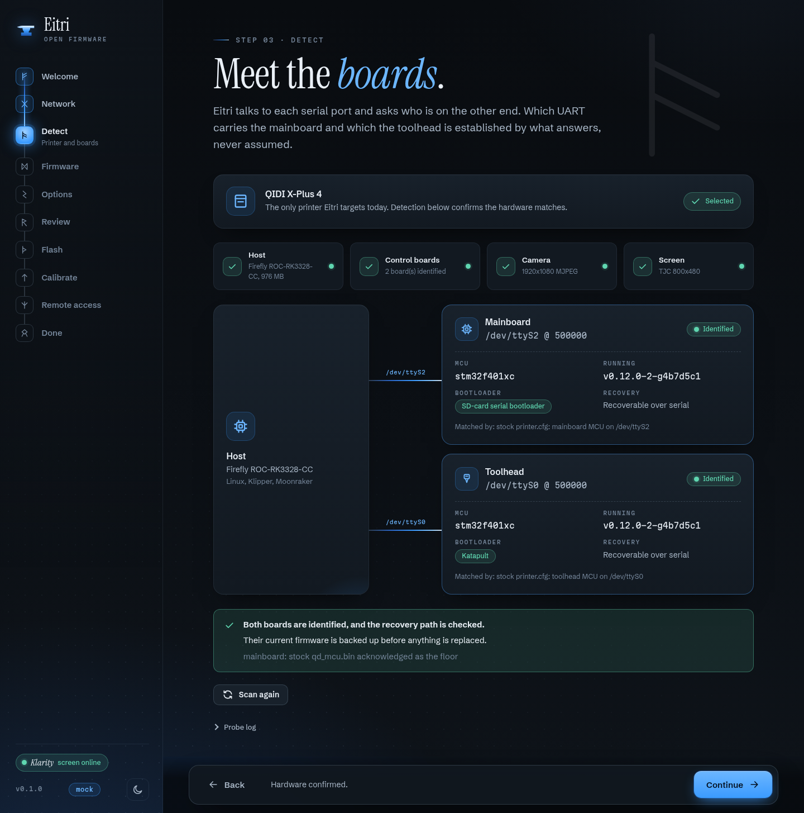
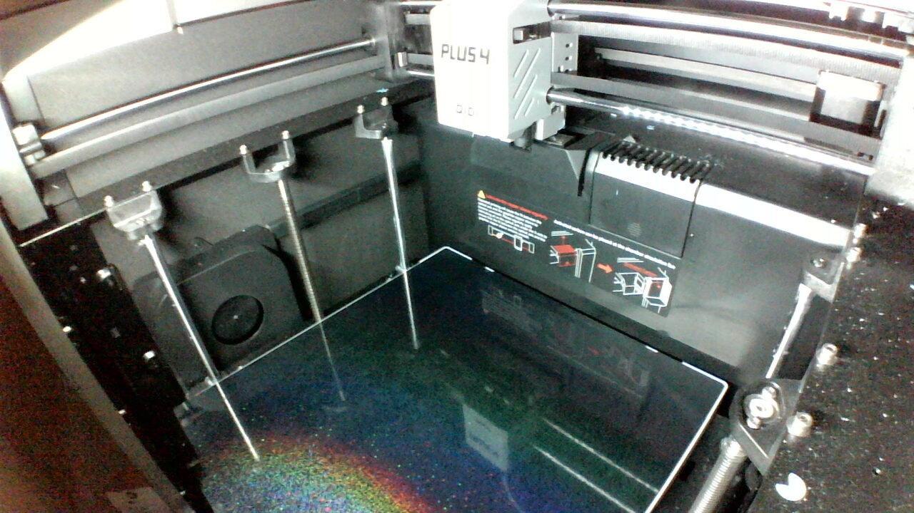
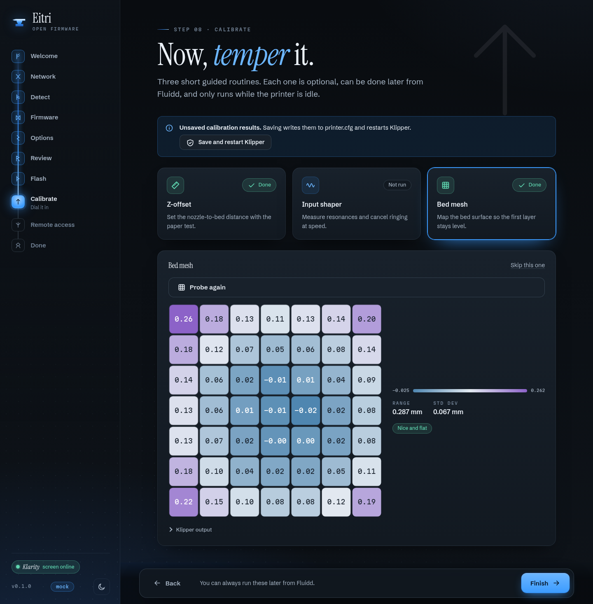

<p align="center">
  <picture>
    <source media="(prefers-color-scheme: dark)" srcset="assets/brand/eitri-lockup-dark.svg">
    
  </picture>
</p>

<p align="center">
  <strong>Open, mainline-clean firmware for the QIDI X-Plus 4.</strong><br>
  Upstream Klipper, an open touchscreen, a read-only A/B system you can roll back.
</p>

<p align="center">
  <a href="https://github.com/MakerViking/eitri/actions/workflows/ci.yml"></a>
  <a href="https://github.com/MakerViking/eitri/actions/workflows/os-image.yml"></a>
  
  
  
</p>

<p align="center">
  
</p>

The QIDI X-Plus 4 ships with an old Debian, a vendor kernel, a patched Klipper fork, and
closed pieces you cannot read or fix. Eitri replaces the printer's software with upstream
parts you can: **pristine Klipper or Kalico**, Moonraker, a **read-only A/B operating
system** built with Buildroot, and **Klarity**, an open daemon that drives the printer's
own touchscreen without reflashing it.

Everything QIDI-specific (the chamber interlock, power-loss recovery, the probe, the
stock toolhead's accelerometer) lives in separate `qd_*` modules beside an **unmodified**
Klipper tree, so `git pull` never conflicts and Moonraker's update manager keeps working.

- **Upstream Klipper, untouched.** A plain clone; QIDI behaviour is linked in from outside
- **Your choice of base**, chosen at install: mainline Klipper (default) or Kalico
- **The stock touchscreen keeps working**, driven by Klarity over its serial line. The display firmware is never rewritten
- **A/B updates with rollback**: a bad update boots the previous system
- **Installs in place over SSH**, keeping QIDI's bootloader, with a verified eMMC backup first
- **Installs offline**: the whole application layer ships as one pinned data seed per base
- **A setup wizard** that identifies each control board by asking it, rather than assuming which port is which
- **1080p camera stream** and Fluidd or Mainsail, without the stock cloud service or its remote tunnel

<p align="center">
  <strong>Pre-alpha. Not released yet.</strong><br>
  <sub>Eitri runs and prints on the developer's X-Plus 4, but there is no release image,
  signed update channel, or installer download yet. <a href="#status">Status</a> says
  exactly what has been proven on the machine and what has not. Please read
  <a href="docs/SAFETY.md">SAFETY.md</a> before anything else.</sub>
</p>

> Named for Eitri, the dwarven smith of Norse myth who forged Mjölnir while his brother
> Brokkr worked the bellows (some tellings call him Sindri). Sibling to
> [SindriCAD](https://github.com/MakerViking/sindricad), parametric CAD, and
> [BrokkrSculpt](https://github.com/MakerViking/brokkrsculpt), sculpting. Those two make
> the model; Eitri runs the printer that makes it real.

<p align="center">
  <a href="#why-eitri">Why Eitri</a> ·
  <a href="#status">Status</a> ·
  <a href="#get-it">Get it</a> ·
  <a href="#safety">Safety</a> ·
  <a href="#how-it-fits-together">How it fits together</a> ·
  <a href="#how-eitri-compares">Compared</a><br>
  <a href="#checking-it">Checking it</a> ·
  <a href="#ai-assistance">AI assistance</a> ·
  <a href="#layout">Layout</a> ·
  <a href="#documentation">Docs</a> ·
  <a href="#licensing">Licensing</a> ·
  <a href="#support">Support</a>
</p>

## Why Eitri

1. **Upstream Klipper stays untouched.** Klipper or Kalico is a plain `git clone` that is
   never edited. QIDI's behaviour lives in `qd_*` extras and config files linked in from
   outside, so an upstream update is a `git pull`, not a merge.
2. **The screen is not reflashed.** Klarity speaks the TJC/Nextion serial protocol to the
   display's existing firmware. Nothing is written to the display, so there is no
   screen-flash brick risk.
3. **The code is open.** Apache-2.0 for the project, GPL for the Klipper extras (matching
   Klipper), AGPL for the printer configuration adapted from QIDI's.
   [Licensing](#licensing) says which file is under which.
4. **You can always get back.** Updates go to the inactive slot of an A/B system and roll
   back if the new one does not come up healthy. The in-place install keeps the stock
   system until you remove it, and [RECOVERY.md](docs/RECOVERY.md) covers the rest, down to
   maskrom over USB.
5. **Releases are pinned and signed with keys CI never sees.** One
   [`release.lock`](release.lock) pins every upstream input. CI builds unsigned artifacts;
   a separate, maintainer-approved job signs them ([RELEASING.md](docs/RELEASING.md)).

## Status

**Pre-alpha, and on one printer.** On 2026-10-23 Eitri was installed in place on the
developer's QIDI X-Plus 4, booted, and **printed**.

**Proven on the machine:**

- the in-place install and first boot; A/B updates (both slots good after a power cycle)
- Klarity driving the stock touchscreen
- every temperature and driver sensor, the chamber, and the filament-width sensor
- the camera at 1080p (the stock camera module is very light-starved; see below)
- sensorless X/Y homing and probe-based Z homing
- the accelerometer, on the stock toolhead firmware
- Wi-Fi, and the setup wizard from pairing through to the end
- printing

<p align="center">
  <br>
  <sub>The X-Plus 4's own camera, streamed by Eitri. The stock module needs a lot of light.</sub>
</p>

**Not there yet**, in roughly the order it will happen:

- **Both control boards still run QIDI's firmware.** The mainboard firmware is built but
  not yet flashed; the toolhead has no bootloader and needs an ST-Link for its first
  flash.
- **A warm `reboot` hangs this board** (the stock boot firmware does not reset the SoC). A
  fix is in the image but not yet verified. Until it is, power-cycle instead.
- **The touchscreen's home-page e-stop does nothing yet**, on purpose, until the button
  is confirmed on the real panel. Stop the printer from the web interface or the mains
  switch ([SAFETY.md](docs/SAFETY.md)).
- Motion tuning on the machine: probe calibration, bed mesh, input shaping, power-loss
  resume, the 85 °C chamber backstop.
- Release engineering: real signing keys, a published update channel, an install on a
  second printer.

The full per-component picture, with test counts and what each piece still needs, is in
[STATUS.md](STATUS.md).

## Get it

**There is nothing to download yet.** No release has been cut, so there is no install
image or signed update channel, and installing Eitri today means building it yourself and
accepting that it has run on exactly one printer.

If you want to follow along or help:

- [INSTALL.md](docs/INSTALL.md) describes the install procedure: an in-place conversion
  over SSH with a verified eMMC backup first, or a flash-once image for bench use.
- `make help` lists the build entry points. `make -C os image` builds the OS image,
  `make seed` the data seeds.
- **Watch or star the repo** to hear when the first release lands.

## Safety

A printer runs a hotend over 300 °C unattended. While Eitri is pre-alpha:

- **stay with the printer while it prints**
- **power-cycle instead of rebooting**
- **stop it from the web interface or the mains switch**, not the touchscreen's home e-stop

Heater runaway protection is active on the hotend, bed and chamber, and the probe must be
calibrated before the first print. [SAFETY.md](docs/SAFETY.md) lists every protection that
is active and every one that has not been exercised on a machine yet.

## How it fits together

<p align="center">
  <br>
  <sub>The setup wizard's calibration step (shown with sample data).</sub>
</p>

```
 L1  Klarity ........... screen daemon        pyserial <-> stock TJC .tft (no reflash)
 L2  qd_* extras ....... GPL-3.0-or-later     symlinked into klippy/extras/
     Klipper | Kalico .. upstream, pristine    never patched
 L3  ustreamer / go2rtc camera streams        1080p MJPEG, optional RTSP
 L0  Buildroot OS ...... glibc, Linux 6.18 LTS read-only A/B rootfs, writable /data
```

- **The OS** is a Buildroot appliance: glibc, mainline Linux 6.18 LTS, systemd, and two
  read-only root slots managed by RAUC. Everything that changes lives on `/data`.
- **The application layer** (Klipper or Kalico, Moonraker, Klarity, the `qd_*` extras and
  their Python environments) is built in CI for the printer's CPU and shipped as one
  **data seed** per base. A first boot needs no network.
- **The setup wizard** runs on port 8099 until setup is done, then shuts itself off. The
  touchscreen can unlock it again, with a fresh pairing code.
- **Updates** come from a signed Eitri channel (OS, data seed and MCU firmware together,
  with rollback), or from upstream directly if you opt in.

The full design (ports, services, partitions, the `/data` layout and the safety
invariants) is in [ARCHITECTURE.md](docs/ARCHITECTURE.md).

## How Eitri compares

The other open projects for this printer family, or the closest ones for other printers,
written from each project's public documentation and licence text as reviewed on
2026-10-21. Corrections welcome; sources are in [COMPARISON.md](docs/COMPARISON.md).

| | **Eitri** | [FreeDi](https://github.com/Phil1988/FreeDi) | [OpenNept4une](https://github.com/OpenNeptune3D/OpenNept4une) | [Simple AF](https://pellcorp.github.io/creality-wiki/prerooted_firmware/) |
|---|---|---|---|---|
| Printer | QIDI X-Plus 4 | QIDI X3, Q1 Pro, X-Plus 4 | Elegoo Neptune 4 family | Creality K1 series |
| Project licence | Apache-2.0; GPL-3.0-or-later for the Klipper extras; AGPL-3.0-or-later for the QIDI-derived printer configuration | Custom "All rights reserved" source-available licence: no derivatives, no reverse engineering | GPL-3.0 | No licence detected by GitHub; not checked further |
| Klipper base | Pristine upstream clone (Klipper or Kalico); QIDI behaviour is separate `qd_*` modules | Upstream Klipper; some QIDI behaviour dropped or bolted on | Upstream Klipper | Klipper with vendor parts removed |
| Touchscreen | Open daemon drives the stock `.tft`; display is **not** reflashed | Ships its own screen firmware, which is flashed to the display | Daemon for Neptune displays, tuned to a vendor-supplied `.tft` | Different display path; no equivalent daemon |
| OS base | Buildroot, glibc, Linux 6.18 LTS, read-only A/B | Armbian | Armbian | Creality-specific pre-rooted image |
| Install model | In-place conversion over SSH (default, keeps the stock bootloader) with a web configurator; a flash-once image for bench and microSD use | Installer script on Armbian, with a setup wizard | Image per model/PCB revision, plus installer script | Pre-rooted image, Wi-Fi via USB, USB factory reset |
| Recovery | A/B rollback; the stock system kept until removed; RK3328 maskrom over USB with `rkdeveloptool` (documented) | Restore-to-stock procedure in its wiki (not verified by us) | Re-flash the image (details not checked) | USB emergency factory reset |
| Maturity | **Pre-alpha: runs and prints on the developer's printer; nothing released** | Released, actively used | Released | Released, actively used |

FreeDi, OpenNept4une and Simple AF have years of field time and Eitri has none. Its bet
is that openness, a clean upstream tree, and a screen path that never reflashes hardware
are worth the effort to build.

## Checking it

```sh
make test        # every component's suite, including real klippy in batch mode (~8 min)
make test-fast   # the same without the klippy integration tests
make lint        # the syntax gate
```

On every push, CI runs **1,879 tests and 1,354 repository checks**. The ones worth knowing
about:

- **The `qd_*` extras run inside real klippy, on both bases.** The `klipper-layer` job
  clones the Klipper and Kalico commits pinned in `release.lock`, builds their MCU data
  dictionaries with the pinned toolchain, and runs the printer configuration through
  klippy in batch mode: homing, print start and end, the chamber interlock, power-loss
  resume. It found a module that stopped Kalico from starting before any printer did.
- **The installer's boot script runs inside a real U-Boot** (a sandbox build of the
  printer's own U-Boot 2021.07) against disk images, and the RAM installer is tested
  through a power cut halfway through the conversion.
- **The data seed is checked as the printer will see it.** Every compiled object is
  checked against the image's C library and shared libraries, and the environments are
  started under qemu-user on an aarch64 root.
- **The OS image itself is built in CI** on every change that touches it (`os-image`). A
  QEMU smoke test boots it with a data seed (passing locally; its CI job is new).
- **The repository checks its own rules**: licence tags per directory, pinned action
  versions, and that no QIDI binary, display asset or key material ever lands in the tree.

## AI assistance

I build this with AI assistance. Code, tests, docs.

I direct it and review what comes out. Every change passes the same gates whatever wrote
it: the syntax gate, the repository checks, every component's test suite, and real klippy
on both Klipper and Kalico. Anything that touches the printer is tried on the printer
before it counts as working, and [STATUS.md](STATUS.md) keeps "proven on the machine"
separate from "tested".

The reasoning lives in the repo rather than in my head. Commit messages record what was
tried and why, and [`docs/`](docs/) carries the design. Judge it on that.

## Layout

```
os/              Buildroot external tree: defconfigs, board files, kernel/U-Boot config, RAUC, QEMU rig
installer/       in-place install over SSH, the RAM installer, eitri-update, eitri-mcuflash
seed/            the offline data seed: build, verify, reference installer
klipper-layer/   qd_* Klipper extras, the printer configuration template, macros
klarity/         touchscreen daemon and the stock screen map
configurator/    first-run setup wizard (port 8099)
camera/          ustreamer and go2rtc integration, camera tuning
mcu/             MCU firmware parameters and build tooling
tools/           repository checks, lint, release tooling
docs/            architecture, install, recovery, safety, releasing, clean-room policy
```

## Documentation

- [ARCHITECTURE.md](docs/ARCHITECTURE.md): layers, partitions, services, ports, the `/data` layout and data seed, MCU flashing, and safety invariants
- [INSTALL.md](docs/INSTALL.md): install paths, the offline data seed, first boot and remote access, Klipper vs Kalico, and update channels
- [SAFETY.md](docs/SAFETY.md): how to stop the printer, the heater protections, and what is not verified on a machine yet
- [RECOVERY.md](docs/RECOVERY.md): eMMC backup and restore, microSD boot, maskrom recovery, and ST-Link as the last resort
- [RELEASING.md](docs/RELEASING.md): how releases are built and signed, key custody, rotation and revocation
- [CLEAN-ROOM.md](docs/CLEAN-ROOM.md): the reverse-engineering and clean-room policy
- [COMPARISON.md](docs/COMPARISON.md): the extended comparison with sources
- [STATUS.md](STATUS.md): per component, what is done or partial, test results, and what needs hardware
- [`release.lock`](release.lock): every pinned upstream version and digest

## Licensing

Every source file that is not Apache-2.0 says so in an `SPDX-License-Identifier` line, and
`tools/check-repo.py` checks that the tags match the table below.

| Path | Licence | Why |
|---|---|---|
| Everything not listed below: Klarity, configurator, installer, camera, OS integration, tools, docs, the flavor files in `klipper-layer/config/flavors/` | **Apache-2.0** ([`LICENSE`](LICENSE)) | Eitri's own work |
| `klipper-layer/config/` except `flavors/`: `printer.cfg.tmpl`, `macros.cfg`, `eitri-variables.toml` | **AGPL-3.0-or-later** (text in `klipper-layer/config/LICENSE`, reasoning in `klipper-layer/config/LICENSE-NOTE.md`) | Adapted from QIDI's `QIDITECH/QIDI_PLUS4`, whose `LICENSE` file is AGPL-3.0 while its README badge says GPL-3.0. Eitri treats the stricter reading as binding |
| `klipper-layer/extras/` (the `qd_*` modules and `gcode_shell_command.py`) | **GPL-3.0-or-later** (`klipper-layer/extras/LICENSE`) | They run inside Klipper, which is GPL-3.0. A file derived from GPLv3-only code says `GPL-3.0-only` in its header |
| Kernel and U-Boot patches, the device tree | GPL-2.0 (device tree: `GPL-2.0+ OR MIT`) | Same as the projects they patch |
| Third-party components | their own licences | listed in [`NOTICE`](NOTICE) |

* A printer configuration rendered from the AGPL template stays on your printer and is
  yours to edit. AGPL section 13 matters only to someone who modifies these files *and*
  offers the result to other people over a network; then they must offer the source.
  Nothing in Eitri changes how you may use your own printer.
* Contributions follow the licence of the directory they land in
  ([CONTRIBUTING.md](CONTRIBUTING.md)).
* Eitri does not include, and must never include, QIDI binaries, `.tft` or `.HMI` assets,
  Cython modules, or decompiled code. See [CLEAN-ROOM.md](docs/CLEAN-ROOM.md).
* This is how the project treats its material, not legal advice.

### Trademarks and non-affiliation

Eitri is an independent project. It is **not affiliated with, endorsed by, or sponsored by
QIDI TECH** or any of its subsidiaries. "QIDI," "QIDI X-Plus 4," and related names and
logos are trademarks of their respective owners and are used here only to identify the
hardware this software is intended to run on. Klipper, Kalico, Moonraker, Fluidd,
Mainsail, FreeDi, OpenNept4une, Simple AF and the other project names mentioned here
belong to their respective projects and are used for comparison and attribution only.

Running Eitri may affect your printer's warranty, support eligibility, and the behaviour
of QIDI's own software. You are responsible for the choices you make on your hardware.

## Contributing, security, and conduct

- [CONTRIBUTING.md](CONTRIBUTING.md): how to propose changes, the clean-tree and safety rules, and the sign-off requirement
- [SECURITY.md](SECURITY.md): the trust model and how to report a vulnerability privately, rather than in the issue tracker
- [CODE_OF_CONDUCT.md](CODE_OF_CONDUCT.md): expected community behaviour

Eitri is pre-alpha and does not yet offer a support channel. Please use the issue tracker
for bugs and questions, and read [RECOVERY.md](docs/RECOVERY.md) before you test anything
on a printer.

## Support

Eitri is free and open source. If you would like to back its development, the money
covers the servers, domains, and tooling behind this and my other projects.

- [PayPal](https://paypal.me/makerviking), what most people pick
- [Ko-fi](https://ko-fi.com/tinkeratlas)
- [TinkerAtlas+](https://tinkeratlas.com/pricing), a monthly plan on the site

You can also back it on [Patreon (MuninWorks)](https://www.patreon.com/MuninWorks).
