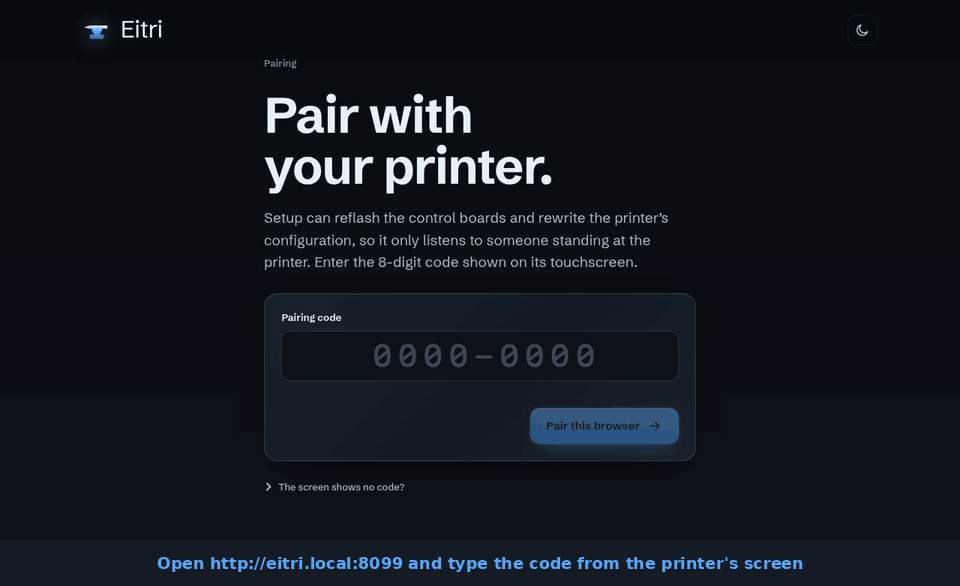
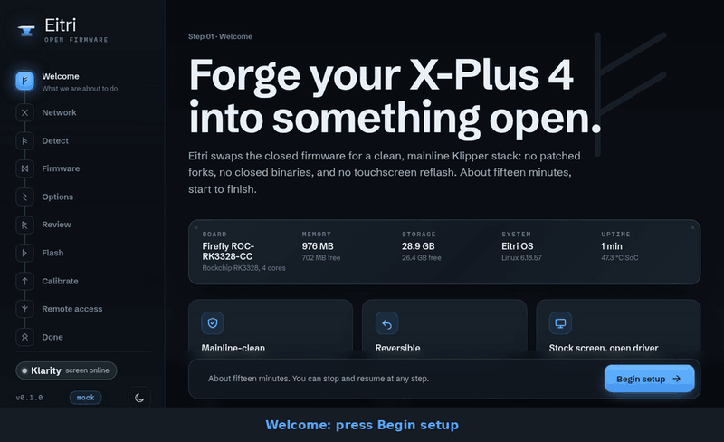
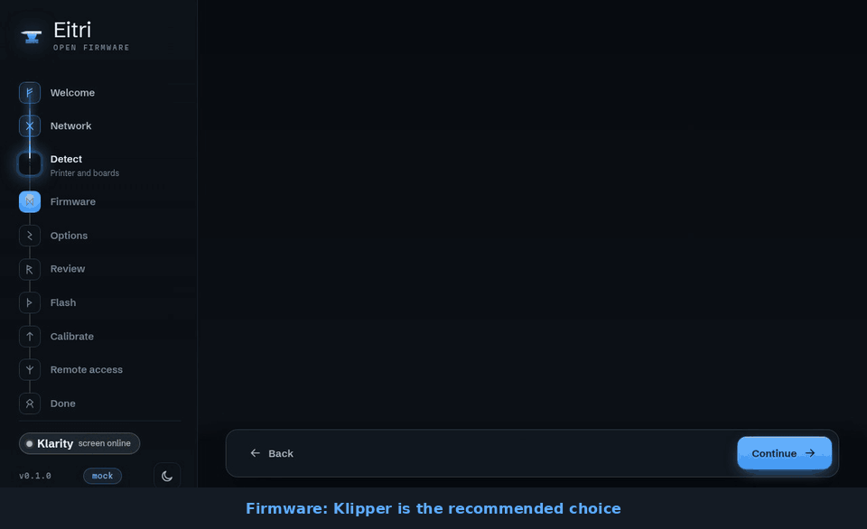
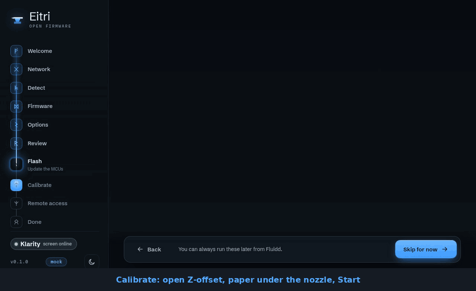
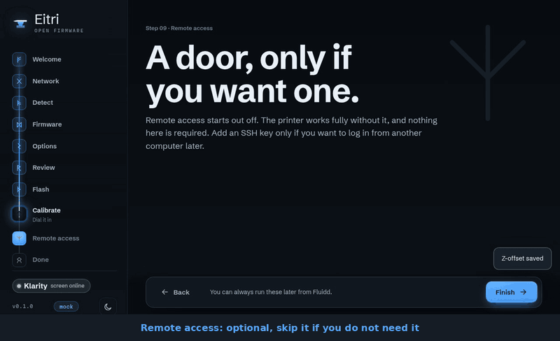

# Install Eitri on your QIDI X-Plus 4: no tools needed

This guide takes you from QIDI's stock firmware to Eitri in about **45 minutes**, from your
computer, over the network. You do not open the printer, flash an SD card or connect a
programmer. The printer's own boards keep their firmware.

> **Pre-alpha: not released yet.** This is how the install will work at the first release.
> Until then there is no download, and the commands below will not find one. Eitri runs and
> prints on the developer's printer; read [SAFETY.md](SAFETY.md) before you use it.

Each step has a short clip. The terminal clips show the installer's real output, recorded on
Eitri's test rig: a virtual X-Plus 4 running a copy of a real printer's eMMC. That is why the
board shows as "QEMU virt". The wizard clips show the real setup wizard. Clips of the printer
itself are marked *to be filmed*.

## What you need

- Your **QIDI X-Plus 4**, connected to your network by cable or Wi-Fi, and **not printing**
- A **computer** on the same network (Windows 10/11, macOS or Linux; nothing to install)
- A **USB stick of 8 GB or more**, for a backup of the printer. Files already on it are kept
- About **45 minutes**, most of it waiting

You do **not** need an ST-Link, an SD card, a USB cable or a screwdriver.

---

## 1. Find your printer's address

On the printer's touchscreen, open **Settings**, then **Network**. Write down the **IP
address**, for example `192.168.0.145`. You will use it in the next steps.

<!-- clip: tutorial/01-find-ip.mp4 (to be filmed: the stock Settings > Network page) -->
*Clip to be filmed: the stock touchscreen's network page.*

## 2. Plug in the USB stick

Put the USB stick in the printer's **front USB port**. The installer saves a complete copy of
the printer's memory to it before it changes anything. That copy is your way back to stock if
you ever want it.

<!-- clip: tutorial/02-usb-stick.mp4 (to be filmed) -->
*Clip to be filmed: the stick going into the front port.*

## 3. Log in to the printer from your computer

Open a terminal: **PowerShell** on Windows, **Terminal** on macOS or Linux. Type, with your
printer's address:

```sh
ssh mks@192.168.0.145
```

The first time it asks whether to trust the printer: type `yes`. The password is QIDI's
default, **`makerbase`** (nothing appears while you type it; that is normal).


## 4. Download the installer and let it look

Still in the terminal, type:

```sh
curl -fsSLO https://github.com/MakerViking/eitri/releases/latest/download/install.sh
sudo bash install.sh
```

This is a **dry run: it changes nothing.** It checks that this is an untouched X-Plus 4,
verifies the download, plans the new layout and says what it would do. Every line should
read `ok`. One `warn` about Moonraker is fine if nothing is printing. If anything says
`FAIL`, stop and [ask for help](#if-something-goes-wrong).


## 5. Install

When the dry run looks good, run it for real:

```sh
sudo bash install.sh --flavor klipper --i-have-a-backup --yes --backup-to-usb
```

1. **The backup** is written to the stick, then read back and checked: 5 to 10 minutes.
   Leave it running.
2. The installer **downloads and verifies Eitri**.
3. It asks you to type **`CONVERT`**. Nothing has been changed until you do. Type it and
   press Enter.
4. The printer **reboots by itself** into a small installer, writes Eitri, and reboots again
   into Eitri: 15 to 25 minutes. **Do not switch the printer off.** If the power does go
   off, the installer carries on where it stopped. Your terminal loses the connection when the
   printer reboots; that is expected. The installer prints a progress page address you can
   open in a browser meanwhile.

Your printer's two control boards are **not touched**. They keep QIDI's firmware, which works
with Eitri. The stock system stays on the printer as a fallback.


## 6. Pair your browser with the printer

When Eitri has started, the touchscreen shows a **pairing code**. On your computer, open:

```
http://eitri.local:8099
```

(If that does not load, use the address from step 1: `http://192.168.0.145:8099`.) Type the
code from the screen. This makes sure only someone standing at the printer can set it up.

<!-- clip: tutorial/06-pairing-screen.mp4 (to be filmed: the code on the touchscreen) -->


## 7. Set it up in the wizard

The wizard goes step by step, with its steps listed on the left. Most need nothing but
**Next**.

**Welcome, Network, Detect.** The network the printer already uses is fine. Detect asks each
control board which one it is, instead of guessing. It then says both boards **keep the
firmware they run now**. That is expected: after an install without tools they keep QIDI's
firmware, and Eitri works with it.



**Firmware, Options, Review, Flash.** Pick **Klipper** (recommended) or Kalico. Under
Options choose the camera, **Fluidd or Mainsail** as the web interface, who may use the
printer from your network, and whether crash reports may be sent (off unless you choose). Review lists the files the
wizard writes; **Write configuration** writes them and starts everything. Flash has nothing
to do: press **Continue**.



## 8. Calibrate the Z-offset

In the wizard's **Calibrate** step, open **Z-offset**, slide a sheet of plain printer paper
under the nozzle and press **Start**. The printer homes and starts the paper test. Lower the
nozzle with the buttons in small steps until the paper **drags slightly** when you move it.
Press **Accept this height**, then **Save and restart Klipper**. Input shaper and bed mesh are
optional; you can run them any time later.



Eitri refuses to start a print until this is done once, so a wrong offset cannot drive the
nozzle into the bed. You can repeat it later from the console of the web interface:
`G28`, then `PROBE_CALIBRATE`, the same paper test, then `ACCEPT` and `SAVE_CONFIG`.

<!-- clip: tutorial/08-probe-calibrate.mp4 (to be filmed: the paper test) -->
*Clip to be filmed: the paper test at the nozzle.*

## 9. Finish and print

**Remote access** is optional: add an SSH key only if you want to log in later. **Done**
links to the web interface and the camera.



Point your slicer (OrcaSlicer, PrusaSlicer, ...) at **`http://eitri.local`**, the same as
any Klipper printer, and print. For the first prints, **stay with the printer**
([SAFETY.md](SAFETY.md)).

---

## Going back to stock

The stock system is still on the printer. To return to it, log in again and run:

```sh
sudo ./revert.sh --hard --yes
```

The printer boots QIDI's firmware again. `revert.sh --to-eitri` goes forward again, and
`revert.sh --full` restores the complete backup from the USB stick. Details are in
[INSTALL.md](INSTALL.md) and [RECOVERY.md](RECOVERY.md).

## If something goes wrong

- **The installer stopped with `FAIL`:** nothing has been changed unless you typed
  `CONVERT`. Copy the last 20 lines of its output into a bug report.
- **After the install:** run the **`EITRI_REPORT`** macro in the web interface. A minute
  later `eitri-report-<time>.tar.gz` appears in the **Logs** folder, with addresses, names
  and keys already removed. Attach it to a bug report ([CONTRIBUTING.md](../CONTRIBUTING.md#reporting-bugs)).
- More answers are in [INSTALL.md, Troubleshooting](INSTALL.md#troubleshooting).
